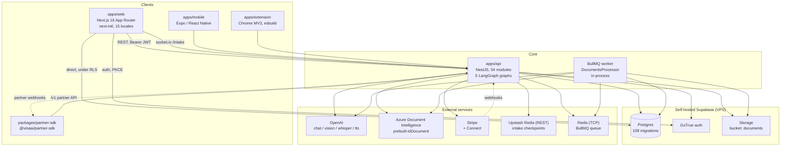
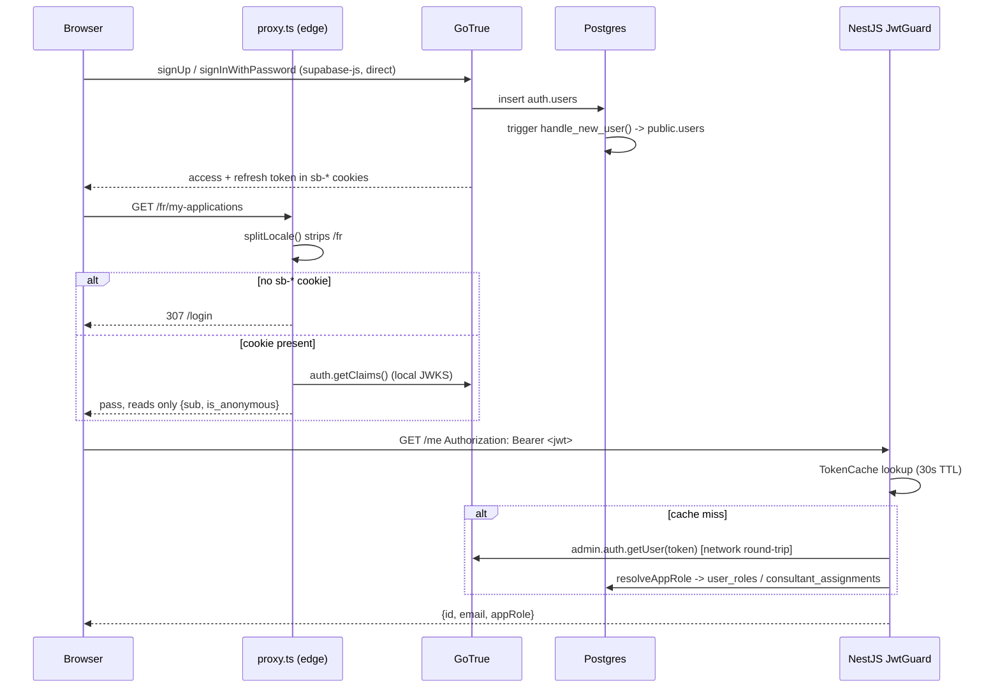
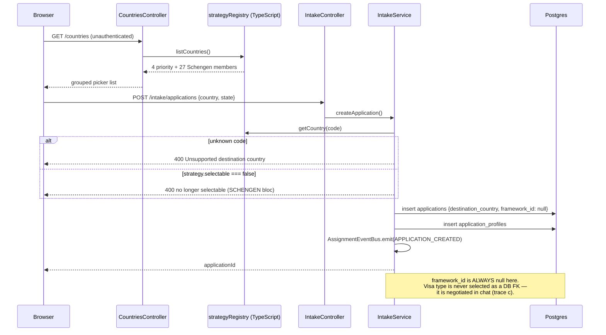
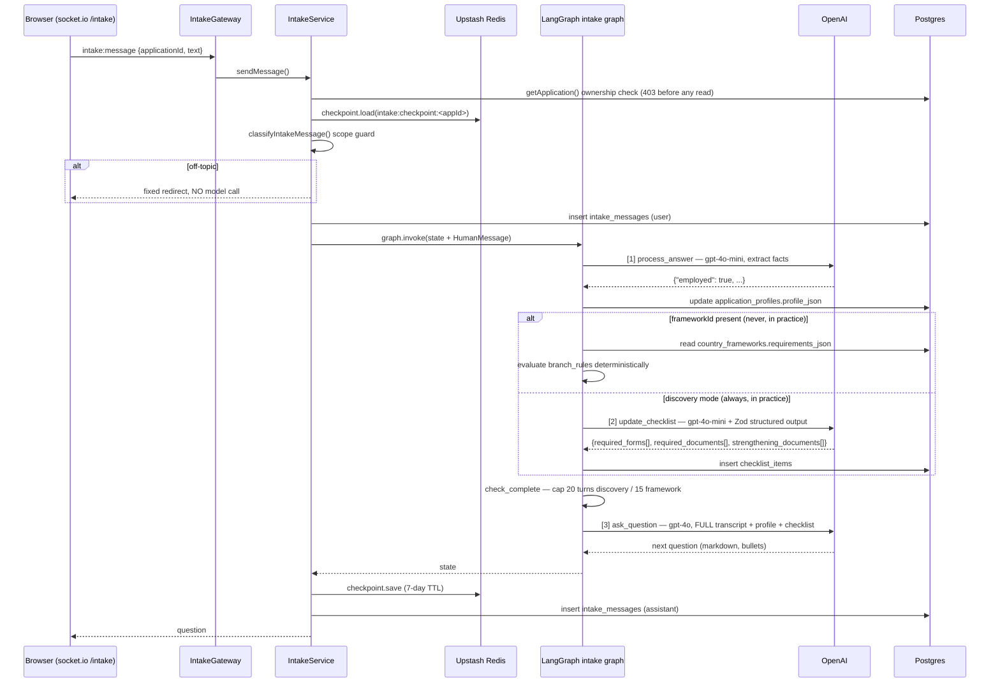
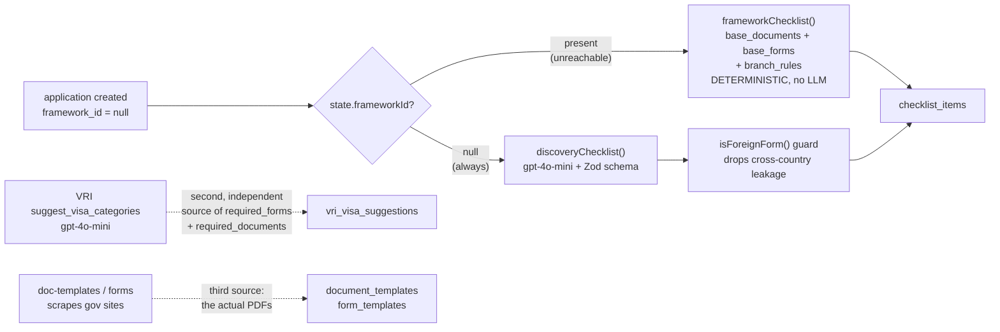
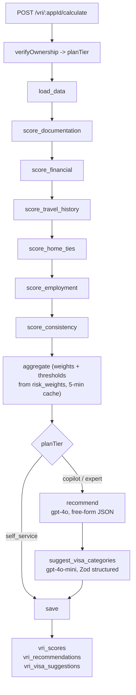
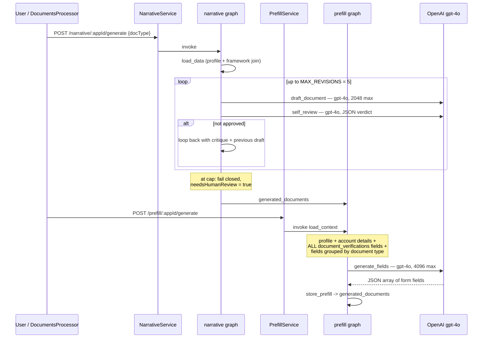
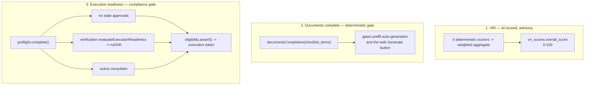
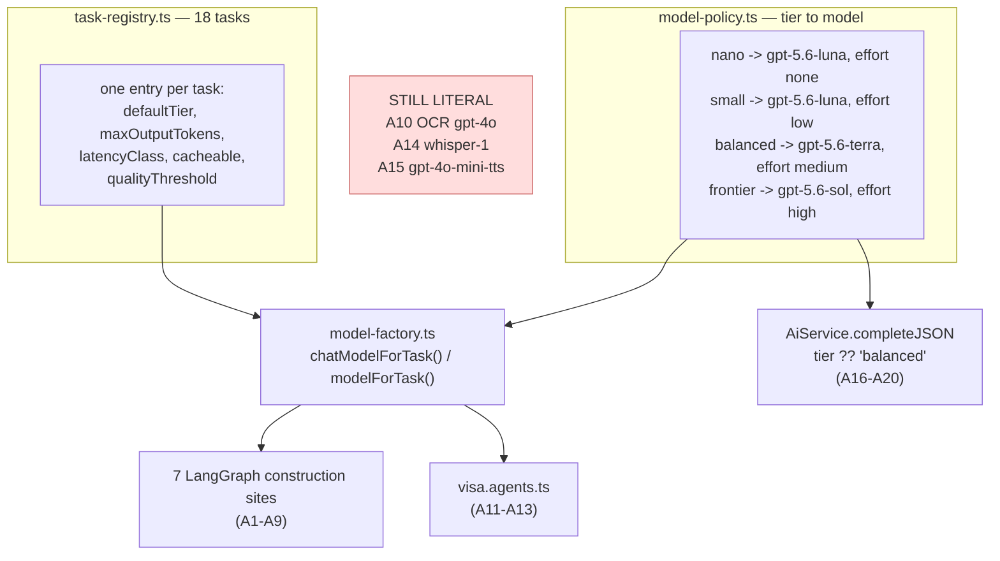

# VisaAI — Current-State Architecture Map

**Status:** descriptive, not aspirational. Every claim below carries a `file:line`
citation into the tree as of 2026-08-21. Where a statement is an inference rather
than something read directly out of the code, it is prefixed **[INFERRED]**.

**Snapshot warning.** Other agents were editing this repository throughout this
pass. The AI layer in particular was refactored *while this document was being
written* (commit `340b7d9` plus uncommitted work) — §4 records both the
before and after states and flags which findings survived. Treat line numbers as
a snapshot, not a durable address; §Appendix gives the commands to re-derive
every count here.

**Scope note.** The brief specified 56 API modules. There are **54** module
directories under `apps/api/src/modules` (counted at
`apps/api/src/modules/`); all 54 are inventoried in §2. Sixty-six `*.module.ts`
files exist in total once `shared/*` sub-modules are counted.

---

## 0. Established facts this document builds on

These were established before this pass and are cited rather than re-derived:

| Fact | Evidence |
|---|---|
| Country data lives in TypeScript strategy classes, not a normalized DB registry | `apps/api/src/strategies/index.ts:15-22` — 4 priority countries + Schengen bloc + 27 members registered in code |
| `country_frameworks` is the only visa-requirement table and ships exactly 1 seeded row | `supabase/migrations/20260531000000_initial_schema.sql:17` (DDL), `:255-256` (the single `CA/TRV/tourism` insert) |
| 12 source files hardcode `gpt-4o` / `gpt-4o-mini` | **was true at the start of this pass; superseded mid-pass — see the banner in §4.** The task registry's own header still cites the same 12 files as its motivation (`apps/api/src/modules/shared/ai/task-registry.ts:6-9`) |
| `AiService` is a partial AI gateway whose model is a string literal | **was true; the literal is now `resolveModel(params.tier ?? 'balanced', …)`** at `apps/api/src/modules/shared/ai/ai.service.ts:80`. It remains partial for the other reasons in §4.3.7 |

Two corrections to the brief, both verified:

1. `strategies/index.ts:21` registers **27** Schengen member strategies
   (`buildSchengenMemberStrategies()`), not 29. `SchengenStrategy` itself is
   registered but marked non-selectable and is rejected at application creation
   (`apps/api/src/modules/intake/intake.service.ts:67-71`).
2. `apps/sidecar` is an **empty directory** — it contains only `node_modules`
   and no source, package.json, or entrypoint. It is matched by the
   `apps/*` workspace glob (`pnpm-workspace.yaml:2`) but contributes nothing.

---

## 1. System context



### What talks to what, and how

| Edge | Mechanism | Evidence |
|---|---|---|
| web → API | `fetch` with `Authorization: Bearer <supabase access token>` | `apps/web/lib/api/client.ts:1,15` |
| web → API (intake) | socket.io namespace `/intake` | `apps/api/src/modules/intake/intake.gateway.ts:20-25` |
| web → Postgres **directly** | supabase-js in the browser, relying on RLS | `apps/web/components/required-docs-gate.tsx:30-35`; `apps/web/app/[locale]/(public)/intake/[applicationId]/page.tsx:14-18` |
| API → Postgres, RLS-scoped | `SupabaseService.forUser(token)` — anon key + caller JWT | `apps/api/src/modules/shared/supabase/supabase.service.ts:105-107` |
| API → Postgres, RLS-bypassing | `SupabaseService.admin` — service-role key | `apps/api/src/modules/shared/supabase/supabase.service.ts:68-71` |
| API → OpenAI | two independent paths: raw `openai` SDK and `@langchain/openai` | §4 |
| API → Azure Doc Intelligence | OCR provider factory, region-aware | `apps/api/src/modules/documents/documents.processor.ts:54-61` |
| API → Upstash | intake LangGraph checkpoints, 7-day TTL | `apps/api/src/modules/shared/langgraph/checkpoint.service.ts:29-54` |
| API → Redis (TCP) | BullMQ document queue | `apps/api/src/modules/documents/documents.service.ts:29,185` |

**There is no BFF.** `apps/web/app/api` contains only four route handlers and
none of them proxies the NestJS API: sign-out
(`apps/web/app/api/auth/signout/route.ts:4-8`), the Supabase OAuth callback
(`apps/web/app/callback/route.ts:10-41`), and the two mobile app-link manifests.

**Two Redis-shaped dependencies, not one.** `UPSTASH_REDIS_REST_URL` /
`UPSTASH_REDIS_REST_TOKEN` are **required** at boot
(`apps/api/src/config/configuration.ts:124-125` — no `.optional()`), while
`REDIS_URL` defaults to `redis://localhost:6379`
(`apps/api/src/config/configuration.ts:126`). The first holds intake
conversation state over HTTP; the second backs BullMQ over TCP.

---

## 2. Module map — 54 API modules

Format: **what it owns** | **primary table(s)** | **route prefix** | **citation**.
"Primary tables" = the tables the module writes to most, measured by `.from('…')`
frequency inside the module directory.

Every module reaches the Nest graph. `app.module.ts` imports 64 of them at
`apps/api/src/app.module.ts:99-169`; the one `*.module.ts` absent from that list,
`PlanReviewPayoutModule` (`apps/api/src/modules/payouts/plan-review-payout.module.ts:23`),
is imported transitively by `apps/api/src/modules/consultant/consultant.module.ts:31`
to avoid a DI cycle. **There are no dead modules.**

### Identity & access

| Module | Owns | Tables | Route | Citation |
|---|---|---|---|---|
| `auth` | `JwtGuard` + `PlanGuard` only — no routes, no service | `applications`, `user_roles` | — | `apps/api/src/modules/auth/auth.module.ts:5` |
| `iam` | 6-role RBAC, orgs, invitations, MFA, login security | `organizations`, `organization_members`, `user_roles` | `iam`, `organizations`, `me/mfa` | `apps/api/src/modules/iam/iam.controller.ts:25` |
| `me` | Current-user self-service: language preference, profile | — (delegates via user client) | `me` | `apps/api/src/modules/me/me.controller.ts:60` |
| `admin` | Admin console: users, roles, audit trail, assignment | `users`, `user_roles`, `auth_audit_log` | `admin` | `apps/api/src/modules/admin/admin.controller.ts:37` |
| `privacy` | GDPR self-service: export, deletion, request tracking | `privacy_requests`, `users` | `me/privacy` | `apps/api/src/modules/privacy/privacy.controller.ts:30` |
| `entitlement` | Global plan-entitlement checks for subscription gating | `subscriptions` | — (`@Global` service) | `apps/api/src/modules/entitlement/entitlement.module.ts:4` |
| `feature-flags` | Kill switches, targeting, `FeatureFlagGuard`, admin CRUD | `feature_flags`, `feature_flag_audit`, `beta_cohort_members` | `feature-flags`, `admin/feature-flags` | `apps/api/src/modules/feature-flags/feature-flags.controller.ts:25` |

### Application lifecycle

| Module | Owns | Tables | Route | Citation |
|---|---|---|---|---|
| `intake` | Intake wizard, application creation, profile, checklist seeding, WS gateway | `checklist_items`, `applications`, `application_profiles` | `intake` | `apps/api/src/modules/intake/intake.controller.ts:32` |
| `countries` | Public destination-country registry, derived live from the strategy registry | — (no DB at all) | `countries` | `apps/api/src/modules/countries/countries.controller.ts:66` |
| `progress` | Cross-module progress computation, consumed by `reminders` | `generated_documents`, `checklist_items`, `vri_scores` | `progress` | `apps/api/src/modules/progress/progress.controller.ts:18` |
| `preflight` | Pre-submission review lock: drift, provenance, stale approvals | `preflight_reviews` | `applications/:id/preflight` | `apps/api/src/modules/preflight/preflight.controller.ts:85` |
| `eligibility` | Final compliance gate before execution | `submission_sessions`, `payments` | — | `apps/api/src/modules/eligibility/eligibility.module.ts:15` |
| `execution` | Server-authoritative execution choke point + readback signer | `consumed_readback_tokens` | `execution` | `apps/api/src/modules/execution/execution.controller.ts:25` |
| `execution-request` | Readback-confirm step: revalidate, emit, mint bound token | — (delegates) | `execution` | `apps/api/src/modules/execution-request/execution-request.controller.ts:53` |
| `portal-fill` | Signed write intents + single-cursor portal execute/verify loop | — (signing only) | — | `apps/api/src/modules/portal-fill/portal-fill.module.ts:24` |
| `automation` | Submission-session automation, extension WS handshake | `submission_sessions`, `documents` | `automation` | `apps/api/src/modules/automation/automation.controller.ts:18` |
| `outcomes` | Visa outcome recording and reporting | `application_outcomes` | `outcomes` | `apps/api/src/modules/outcomes/outcomes.controller.ts:20` |
| `reminders` | Scheduled reminder emails via BullMQ, driven by `ProgressService` | `reminder_log`, `applications` | `reminders` | `apps/api/src/modules/reminders/reminders.controller.ts:10` |

### Documents

| Module | Owns | Tables | Route | Citation |
|---|---|---|---|---|
| `documents` | Upload presign, checklist items, verification, OCR queue | `documents`, `checklist_items`, `document_verifications` | `documents` | `apps/api/src/modules/documents/documents.controller.ts:20` |
| `forms` | Official blank-form cache, robots gate, revisions, weekly sweep | `form_templates`, `template_revisions`, `template_sweep_findings` | `forms`, `template-ops` | `apps/api/src/modules/forms/forms.controller.ts:22` |
| `doc-templates` | Official document delivery: checklists, photo specs, declarations | `document_templates` | `document-templates` | `apps/api/src/modules/doc-templates/doc-templates.controller.ts:21` |
| `provenance` | Field value-hash provenance and OCR run traces | `field_provenance`, `ocr_runs` | — | `apps/api/src/modules/provenance/provenance.module.ts:11` |
| `verification` | Field/section verification state and drift detection | `field_verifications`, `section_verification` | — | `apps/api/src/modules/verification/verification.module.ts:12` |

### AI

| Module | Owns | Tables | Route | Citation |
|---|---|---|---|---|
| `vri` | Visa Readiness Index scoring, suggestions, risk config, escalation | `vri_scores`, `vri_visa_suggestions` | `vri`, `admin/risk-config` | `apps/api/src/modules/vri/vri.controller.ts:13` |
| `narrative` | AI-generated LOE / itinerary / cover-letter documents | `generated_documents` | `narrative` | `apps/api/src/modules/narrative/narrative.controller.ts:23` |
| `prefill` | Renders official form templates prefilled from application data | `generated_documents`, `checklist_items` | `prefill` | `apps/api/src/modules/prefill/prefill.controller.ts:35` |
| `visa` | 3-agent research → evaluation → copywriter pipeline | — (no DB at all) | `visa` | `apps/api/src/modules/visa/visa.controller.ts:25` |
| `voice` | Voice assistant sessions, transcripts, consents | `voice_sessions`, `voice_transcript_turns`, `voice_consents` | `voice` | `apps/api/src/modules/voice/voice.controller.ts:60` |
| `shared` | Infra: Supabase, payments, **AI gateway**, crypto, queue, email, push, SMS | `users`, `ai_usage_events` | — | `apps/api/src/modules/shared/ai/ai.module.ts:7` |

### Marketplace & consultant

| Module | Owns | Tables | Route | Citation |
|---|---|---|---|---|
| `marketplace` | Consultant profiles, skills, availability, discovery, reviews | `consultant_profiles`, `consultant_skills`, `consultant_reviews` | `marketplace/*` | `apps/api/src/modules/marketplace/discovery.controller.ts:38` |
| `consultant` | Assignments, country scope, AI review assistant, approvals | `consultant_assignments`, `applications`, `consultant_countries` | `applications/:id/consultant`, `consultant` | `apps/api/src/modules/consultant/consultant.controller.ts:48` |
| `matching` | Consultant candidate ranking and scoring for auto-routing | `consultant_profiles`, `consultant_assignments` | `matching` | `apps/api/src/modules/matching/matching.controller.ts:19` |
| `consultations` | Consultation scheduling against consultant availability | `consultations`, `consultant_availability` | `consultations` | `apps/api/src/modules/consultations/consultations.controller.ts:57` |
| `messaging` | Consultant↔user conversations, attachments, notes, escalation, SSE | `messages`, `conversations`, `escalation_history` | `messaging` | `apps/api/src/modules/messaging/messaging.controller.ts:62` |
| `partner` | Enterprise partner API: keys, OAuth, outbound webhooks, portal | `partner_api_keys`, `partner_webhook_endpoints`, `partner_webhook_deliveries` | `v1`, `partner/oauth`, `partner-portal` | `apps/api/src/modules/partner/partner-v1.controller.ts:101` |

### Payments

| Module | Owns | Tables | Route | Citation |
|---|---|---|---|---|
| `billing` | Checkout, payments, service orders, **Stripe webhook endpoints** | `applications`, `consultant_service_orders`, `payments` | `billing` | `apps/api/src/modules/billing/billing.controller.ts:61` |
| `subscriptions` | Subscription lifecycle, plan changes, credit grants and caps | `subscriptions`, `subscription_credits` | `subscriptions` | `apps/api/src/modules/subscriptions/subscriptions.controller.ts:30` |
| `pricing` | Dynamic pricing engine, quotes, nightly recompute, admin config | `pricing_visa_tiers`, `pricing_quotes`, `pricing_country_factors` | `pricing` | `apps/api/src/modules/pricing/pricing.controller.ts:22` |
| `discounts` | Admin coupon CRUD + redemption with a pricing-floor guardrail | `coupons`, `discount_redemptions` | `admin/coupons` | `apps/api/src/modules/discounts/discounts.admin.controller.ts:51` |
| `commission` | Marketplace revenue-split authority; commission rules | `consultant_commission_rules` | `admin/commission-rules` | `apps/api/src/modules/commission/commission.controller.ts:22` |
| `payouts` | Stripe Connect onboarding, consultant payouts, payout batches | `consultant_payouts`, `consultant_payout_items` | `payouts`, `admin/payouts` | `apps/api/src/modules/payouts/payouts.controller.ts:26` |
| `financial-ops` | Disputes, dunning, refunds, financial reporting | `payments`, `payment_dunning`, `refunds`, `payment_disputes` | `admin` | `apps/api/src/modules/financial-ops/financial-ops.controller.ts:29` |
| `reconciliation` | Daily payment reconciliation job, runs and exceptions | `reconciliation_runs`, `reconciliation_exceptions` | — | `apps/api/src/modules/reconciliation/reconciliation.module.ts:13` |
| `ledger` | Global payment-event recorder; idempotency gate for webhooks | `payment_events` | — (`@Global`) | `apps/api/src/modules/ledger/ledger.module.ts:12` |
| `billing-analytics` | Admin revenue/MRR analytics with CSV export | `subscriptions`, `refunds` | `admin` | `apps/api/src/modules/billing-analytics/billing-analytics.controller.ts:14` |

### Analytics

| Module | Owns | Tables | Route | Citation |
|---|---|---|---|---|
| `analytics` | Event bus, ingest, rollup, retention pipeline | `analytics_event_stream`, `analytics_event_daily` | `analytics` | `apps/api/src/modules/analytics/analytics.controller.ts:16` |
| `analytics-metrics` | KPI registry, daily/funnel/cohort rollup engine | `kpi_metric_daily`, `kpi_funnel_daily`, `kpi_retention_cohort` | — | `apps/api/src/modules/analytics-metrics/analytics-metrics.module.ts:48` |
| `analytics-api` | Saved/scheduled report query API, exports, metric cache | `analytics_saved_report`, `analytics_scheduled_report`, `analytics_report_run` | `analytics/reports` | `apps/api/src/modules/analytics-api/controllers/metrics.controller.ts:35` |
| `analytics-alerts` | Metric alert rules, threshold evaluation and firing | `analytics_alert_rule`, `analytics_alert_event` | `analytics/alerts` | `apps/api/src/modules/analytics-alerts/alerts.controller.ts:30` |

### Ops

| Module | Owns | Tables | Route | Citation |
|---|---|---|---|---|
| `audit` | Sole system-of-record audit writer; repository deliberately unexported | `audit_events` | — (`@Global`) | `apps/api/src/modules/audit/audit.module.ts:16` |
| `event-bus` | Global in-process assignment-lifecycle bus | — (RxJS `Subject`) | — (`@Global`) | `apps/api/src/modules/event-bus/event-bus.module.ts:9` |
| `realtime` | SSE consultant-queue delivery; pure transport | — | `realtime/consultant-queue` | `apps/api/src/modules/realtime/realtime.controller.ts:22` |
| `notifications` | Dispatch, templates, deliveries, broadcasts, ops console, outbox | `notification_deliveries`, `notification_templates`, `notification_outbox` | `notifications`, `admin/broadcasts` | `apps/api/src/modules/notifications/notifications.controller.ts:43` |
| `feedback` | Beta feedback capture and admin triage | `beta_feedback` | `feedback`, `admin/feedback` | `apps/api/src/modules/feedback/feedback.controller.ts:80` |

### Route-prefix collisions worth knowing

Four modules register `@Controller('admin')` — `admin` (`admin.controller.ts:37`),
`billing-analytics` (`:14`), `financial-ops` (`:29`) — and resolution depends on
`imports` ordering at `apps/api/src/app.module.ts:123-124` vs `:161`. Likewise
`execution` (`execution.controller.ts:25`) and `execution-request`
(`execution-request.controller.ts:53`) both claim `execution`, and
`iam/profile.controller.ts:21` claims `me` alongside `me/me.controller.ts:60`.

---

## 3. Data flow traces

### (a) Registration and authentication



| Step | Evidence |
|---|---|
| Auth is browser↔GoTrue direct; the API never issues tokens | `apps/web/app/callback/route.ts:10-41` |
| DB user row auto-provisioned by trigger | `supabase/migrations/20260531000000_initial_schema.sql:240-252` |
| Edge gate; everything not on the public list requires a user | `apps/web/proxy.ts:104-131` |
| Locale stripped before auth classification | `apps/web/proxy.ts:24-31` |
| **No local JWT signature verification in the API** | there is no `jose`/`jsonwebtoken`/JWKS import in `apps/api/src`; `SUPABASE_JWT_SECRET` is declared at `apps/api/src/config/configuration.ts:27` and never read |
| Verification is a GoTrue HTTP call using the service-role client | `apps/api/src/modules/auth/jwt.guard.ts:152` |
| 30-second in-process token cache | `apps/api/src/modules/auth/token-cache.ts`, TTL wired at `apps/api/src/modules/auth/jwt.guard.ts:112` |
| Role resolution order (claim → admin allow-list → `user_roles` → assignment → `'user'`) | `apps/api/src/modules/auth/jwt.guard.ts:238-283` |

Consequence: token revocation lags by up to the cache TTL, and every cold auth
costs a network round-trip to GoTrue.

### (b) Application creation → country selection → visa selection



| Step | Evidence |
|---|---|
| Country list derived live from the strategy registry, no DB | `apps/api/src/modules/countries/countries.controller.ts:66-75` |
| Web fetches it rather than hardcoding | `apps/web/lib/use-supported-countries.ts:18-26,50` |
| Backend rejects unsupported codes | `apps/api/src/modules/intake/intake.service.ts:57-62` |
| Non-selectable bloc rejected | `apps/api/src/modules/intake/intake.service.ts:67-71` |
| Insert with `framework_id: input.frameworkId ?? null` | `apps/api/src/modules/intake/intake.service.ts:75-84` |
| **No web caller ever sends a `frameworkId`** — measured 0/4 rows | `apps/api/src/modules/forms/forms.service.spec.ts:344-352` |

**This is the single most consequential fact in the system.** `framework_id` is
null for every real application, so `country_frameworks` — the only
visa-requirement table — is never joined successfully, and every downstream
"what does this visa require?" question falls through to an LLM. See traces (c)
and (d).

### (c) Intake questionnaire → conditional questions



**Three OpenAI calls per user turn.** The "conditional questions" mechanism has
two implementations and only the LLM one is reachable:

| Path | Where | Reachable? |
|---|---|---|
| Deterministic `branch_rules` — `{condition: {question, answer}, add: [...]}` evaluated against `profileJson` | `apps/api/src/modules/intake/graphs/nodes/update-checklist.ts:159`, evaluated `:244-265` | **No.** Requires `state.frameworkId`, which is always null (trace b). The one seeded framework's rules live at `supabase/migrations/20260531000000_initial_schema.sql:264-270` |
| LLM discovery | `apps/api/src/modules/intake/graphs/nodes/update-checklist.ts:270-436` | **Yes, always** |

Router that chooses between them: `apps/api/src/modules/intake/graphs/nodes/update-checklist.ts:149-151`.

Other mechanics worth recording:

- Turn 1 of an English discovery intake is served **without** a model call —
  a hardcoded "purpose of your visit" question at
  `apps/api/src/modules/intake/graphs/nodes/ask-question.ts:227-237`. Non-English
  users fall through to the LLM so turn 1 is localized.
- Conversation state lives in **Upstash Redis with a 7-day TTL**
  (`apps/api/src/modules/shared/langgraph/checkpoint.service.ts:50-53`). The
  durable transcript is `intake_messages`, but the graph state is not durable.
- `messages` uses `messagesStateReducer`
  (`apps/api/src/modules/intake/graphs/intake.state.ts:1`), which **appends**.
  `ask_question` then sends `...state.messages` verbatim
  (`apps/api/src/modules/intake/graphs/nodes/ask-question.ts:270`). Prompt size
  grows linearly with turn count, unbounded up to the 20-turn cap.
- Completion is a turn cap, not a data-sufficiency test, in discovery mode:
  `apps/api/src/modules/intake/graphs/nodes/check-complete.ts:23-24`.

### (d) Document requirement generation



There are **three independent sources of truth** for "what documents does this
visa need", and they do not reconcile:

1. `update-checklist` discovery LLM →
   `checklist_items` (`apps/api/src/modules/intake/graphs/nodes/update-checklist.ts:336-345`)
2. `suggest-visa-categories` LLM →
   `vri_visa_suggestions.required_forms` / `.required_documents`
   (`apps/api/src/modules/vri/graphs/nodes/suggest-visa-categories.ts:136-139`)
3. Deterministic scraping of government portals →
   `form_templates` / `document_templates`
   (`apps/api/src/modules/doc-templates/doc-discovery.ts`, no AI involved)

Source 3 is the only one that is actually correct by construction. Sources 1
and 2 are two different models, at two different points in the funnel, both
inventing form codes and both needing a regex backstop to strip the wrong
country's forms: `isForeignForm()` at
`apps/api/src/modules/intake/graphs/nodes/update-checklist.ts:362-367` and
`FORM_PATTERN` rescue at
`apps/api/src/modules/vri/graphs/nodes/suggest-visa-categories.ts:177-189`.

### (e) Document upload → OCR → field extraction → profile fold-back

```mermaid
sequenceDiagram
    participant B as Browser
    participant DC as DocumentsController
    participant ST as Supabase Storage
    participant Q as BullMQ document-ocr
    participant P as DocumentsProcessor
    participant G as LangGraph document graph
    participant OCR as Azure / OpenAI vision
    participant OAI as OpenAI gpt-4o-mini
    participant PG as Postgres

    B->>DC: POST /documents/presign/:appId
    DC->>ST: createSignedUploadUrl (RLS-scoped client)
    DC-->>B: uploadUrl rewritten via toPublicStorageUrl
    B->>ST: PUT bytes to userId/appId/ts-name
    B->>DC: POST /documents/register/:appId
    DC->>PG: insert documents; checklist_items.status='uploaded'
    DC->>Q: add('process', {...}) attempts 3, exp backoff 5s

    Q->>P: process(job)
    P->>G: graph.invoke()
    G->>ST: fetch_document — createSignedUrl(path, 60)
    G->>G: scan_document — malware gate
    G->>OCR: run_ocr — provider-agnostic, residency-guarded
    OCR-->>G: {text, fields}
    G->>OAI: derive_fields — gap-fill per-type schema (skipped if nothing missing)
    OAI-->>G: {key: value}
    Note over G: provider fields WIN; derive only adds
    G->>G: detect_language (heuristic, no AI)
    G->>G: detect_duplicate -> store_verification -> evaluate_expiry
    G->>G: check_docs_ready -> run_cross_verification
    G->>PG: sync_checklist
    G->>PG: sync_profile — mergeExtractedIntoProfile(), gap-fill only
    G-->>P: state

    loop for EACH extracted field (N+1)
        P->>PG: provenance.createFieldProvenance()
    end
    P->>PG: verification.ensureFields(seeds)
    P->>P: prefill.autoGenerateIfReady() [best effort]
    P->>P: translation.translateDocument() [if needs_translation && residency=global]
```

| Step | Evidence |
|---|---|
| Presign uses the **RLS-scoped** client, path `${userId}/${applicationId}/...` | `apps/api/src/modules/documents/documents.service.ts:53-58` |
| Signed URL rewritten off the loopback Kong address | `apps/api/src/modules/shared/supabase/supabase.service.ts:96-101` — the comment at `:77-94` records that this silently broke every upload in production |
| Queue options: 3 attempts, exponential backoff 5s | `apps/api/src/modules/documents/documents.service.ts:185-200` |
| 14-node graph, fixed linear order | `apps/api/src/modules/documents/graphs/document.graph.ts:69-84` |
| `derive_fields` skips the call when nothing is missing | `apps/api/src/modules/documents/graphs/nodes/derive-fields.ts:103-107` |
| Provider fields always win over derived | `apps/api/src/modules/documents/graphs/nodes/derive-fields.ts:143` |
| Profile fold-back is **gap-fill only** — never overwrites an applicant-supplied value | `apps/api/src/modules/documents/graphs/nodes/sync-profile.ts:108-137`, upsert at `:166-171` |
| **N+1**: one provenance insert per extracted field, serial | `apps/api/src/modules/documents/documents.processor.ts:165-181` |
| Auto-prefill triggered here, best-effort | `apps/api/src/modules/documents/documents.processor.ts:199` |
| Translation gated on residency mode | `apps/api/src/modules/documents/documents.processor.ts:217-241` |

### (f) VRI scoring and recommendation



Six scorers are **pure deterministic functions** — no AI —
(`apps/api/src/modules/vri/graphs/scoring/*.ts`, wired at
`apps/api/src/modules/vri/graphs/vri.graph.ts:43-48`). Only the last two nodes
call a model, and both are skipped for `self_service`
(`apps/api/src/modules/vri/graphs/vri.graph.ts:76-83`). Weights and thresholds
are tenant-configurable with a 5-minute in-process cache
(`apps/api/src/modules/vri/risk-config.service.ts:42-43,66`).

Unassessed factors are excluded from recommendations so the user is never told
to fix a dimension that was never measured
(`apps/api/src/modules/vri/graphs/nodes/generate-recommendations.ts:44-51`).

### (g) Narrative and prefill generation



The narrative loop is genuinely unbounded up to 5 revisions, i.e. **2–10 gpt-4o
calls per document** (`apps/api/src/modules/narrative/graphs/nodes/self-review.ts:11,55-64`;
router at `:107-111`). Both failure modes fail closed — an unreadable reviewer
response re-drafts rather than approving (`:87-97`).

Prefill has two entrypoints and they are **not** equivalent:

| Entrypoint | Metered? | Evidence |
|---|---|---|
| `POST /prefill/:appId/generate` (user-initiated) | Yes — `this.meter` passed | `apps/api/src/modules/prefill/prefill.service.ts:55-58` |
| `autoGenerateIfReady()` (fired from the OCR worker) | **No** — meter argument omitted | `apps/api/src/modules/prefill/prefill.service.ts:94` |

So the background path issues a `gpt-4o` call with `maxTokens: 4096` carrying
the entire applicant profile and every extracted document field, and it never
reaches `ai_usage_events`.

### (h) Readiness evaluation

There are **three** distinct, unrelated notions of "ready" in the codebase:



| Notion | Entry point | Evidence |
|---|---|---|
| VRI | `POST /vri/:appId/calculate` | `apps/api/src/modules/vri/vri.controller.ts:20` |
| Documents complete | `documentsCompletion()` in `@visaai/types` | consumed at `apps/api/src/modules/prefill/prefill.service.ts:82` and mirrored in the browser at `apps/web/components/required-docs-gate.tsx:37-43` |
| Execution readiness | `POST /applications/:id/preflight/reviews/:id/complete` | `apps/api/src/modules/preflight/preflight.service.ts:197-206`, `validateLock` at `:276-279` |

Only #3 actually blocks submission. #1 is advisory and is what the product
markets. #2 is duplicated across the tier boundary (see §9).

---

## 4. Complete OpenAI callsite inventory

> **Read this first — the AI layer changed while this document was being
> written.** When this pass began, all 20 callsites selected their model with a
> hardcoded string literal across 12 files. Partway through, a concurrent agent
> landed commit `340b7d9` (*"feat(visa-data,ai): normalized visa registry, typed
> rules engine, AI task/model policy"*) plus further uncommitted work,
> introducing a **task registry** (`apps/api/src/modules/shared/ai/task-registry.ts`),
> a **tier→model policy** (`apps/api/src/modules/shared/ai/model-policy.ts`) and a
> **single model factory** (`apps/api/src/modules/shared/ai/model-factory.ts`).
> Both states are recorded below: the "was" column is the baseline that motivated
> the redesign, the "now" column is the state as of this snapshot. The tree is
> being actively edited, so treat line numbers in §4.1 as a snapshot.

**20 callsites across 19 files.** The file set is exhaustive — every file in
`apps/` and `packages/` importing `openai`, `@langchain/openai`, or
`openai/helpers`, excluding `dist/` and `*.spec.ts`.

### 4.0 The routing layer as it now stands



Tier table: `apps/api/src/modules/shared/ai/model-policy.ts:71-75` (models) and
`:83-87` (reasoning effort). Note `nano` and `small` resolve to the **same
model** — they differ only in `reasoning.effort`, because the 5.6 family has no
nano member (`model-policy.ts:25-27`).

The factory's own header records the two structural bugs the old shape carried:
the model name was duplicated into `makeMeteringCallback(..., 'gpt-4o')` so a
drift silently mispriced every call, and `maxTokens: 1024` was copy-pasted
regardless of whether the node emits a three-word label or a two-page letter
(`apps/api/src/modules/shared/ai/model-factory.ts:12-31`).

### 4.1 Routing table

`JSON` column: **SO** = OpenAI structured outputs (schema-enforced); **JM** =
`response_format: json_object`; **regex** = free-form text with
`raw.match(/\{...\}/)` afterwards; **none** = prose.

| # | file:line | Module | What the call does | Was | Task → tier → model **now** | JSON | Consumer | Interactivity | Cached? |
|---|---|---|---|---|---|---|---|---|---|
| A1 | `intake/graphs/nodes/ask-question.ts:281` | intake | Next interview question + strategy commentary | `gpt-4o` | `intake_question_generation` → small → `gpt-5.6-luna` (`intake.graph.ts:35`) | none | **user-facing** prose | **interactive**, blocks the chat | no |
| A2 | `intake/graphs/nodes/process-answer.ts:39` | intake | Extract snake_case facts from the answer | `gpt-4o-mini` | `intake_answer_extraction` → nano → `gpt-5.6-luna` (`intake.graph.ts:40`) | **regex** | machine → `profile_json` | interactive (in-turn) | no |
| A3 | `intake/graphs/nodes/update-checklist.ts:339` | intake | Discover required forms + docs + strengthening evidence | `gpt-4o-mini` | `intake_answer_extraction` → nano → `gpt-5.6-luna` | **SO** (Zod) | machine → `checklist_items` | interactive (in-turn) | no |
| A4 | `vri/graphs/nodes/generate-recommendations.ts:55` | vri | One recommendation per weak VRI factor | `gpt-4o` | `vri_assessment` → balanced → `gpt-5.6-terra` (`vri.graph.ts:34`) | **regex** | **user-facing** | interactive | no |
| A5 | `vri/graphs/nodes/suggest-visa-categories.ts:125` | vri | 3–5 visa categories + likelihood + forms + docs | `gpt-4o-mini` | `visa_category_suggestion` → small → `gpt-5.6-luna` (`:88`) | **SO** (Zod) | both | interactive | no |
| A6 | `narrative/graphs/nodes/draft-document.ts:38` | narrative | Draft LOE / itinerary / cover letter | `gpt-4o` | `user_draft_generation` → balanced → `gpt-5.6-terra` (`narrative.graph.ts:21`) | none | **user-facing** document | interactive | no |
| A7 | `narrative/graphs/nodes/self-review.ts:66` | narrative | Approve/critique the draft; loops up to 5× | `gpt-4o` | `user_draft_generation` → balanced → `gpt-5.6-terra` | **regex** | machine (loop control) | interactive | no |
| A8 | `prefill/graphs/nodes/generate-fields.ts:73` | prefill | Complete prefilled government form field set | `gpt-4o` | `form_prefill` → balanced → `gpt-5.6-terra` (`prefill.graph.ts:17`) | **regex** | both (goes into a gov form) | **both** — see A8 note | no |
| A9 | `documents/graphs/nodes/derive-fields.ts:132` | documents | Gap-fill per-type schema over OCR text | `gpt-4o-mini` | `field_extraction` → small → `gpt-5.6-luna` (`:25,92`) | **regex** | machine → `document_verifications` | **background** (BullMQ) | skipped if no missing keys |
| A10 | `documents/ocr/openai-ocr.provider.ts:87` | documents | Vision OCR: image → `{text, fields}` | `gpt-4o` | **NOT MIGRATED — still `gpt-4o` literal at `:85`** | **JM** | machine | **background** (BullMQ) | no |
| A11 | `visa/visa.agents.ts:87` | visa | Research a country+visa's requirements | `gpt-4o-mini` | `visa_requirement_estimate` → small → `gpt-5.6-luna` (`:20,88`) | **SO** | machine → next stage | interactive | no |
| A12 | `visa/visa.agents.ts:136` | visa | Evaluate profile vs requirements → probability | `gpt-4o` | `profile_evaluation` → balanced → `gpt-5.6-terra` (`:21,137`) | **SO** | machine → next stage | interactive | no |
| A13 | `visa/visa.agents.ts:186` | visa | Render evaluation as a Markdown strategy report | `gpt-4o-mini` | `recommendation_copy` → small → `gpt-5.6-luna` (`:22,187`) | none | **user-facing** | interactive | no |
| A14 | `voice/providers/openai-stt.provider.ts:50` | voice | Speech → text | `whisper-1` | **NOT MIGRATED — literal at `:33`** | n/a | machine | **interactive**, hard real-time | no |
| A15 | `voice/providers/openai-tts.provider.ts:56` | voice | Text → speech (mp3) | `gpt-4o-mini-tts` | **NOT MIGRATED — literal at `:38`** | n/a | **user-facing** audio | **interactive**, hard real-time | no |
| A16 | `voice/voice-orchestration.service.ts:165` | voice | The voice assistant's answer turn | `gpt-4o` † | `AiService` → `tier ?? 'balanced'` → `gpt-5.6-terra` | **JM** | **user-facing** (spoken) | **interactive**, hard real-time | no |
| A17 | `consultant/ai-review-assistant.service.ts:522` | consultant | Consultant-facing improvement suggestions | `gpt-4o` † | same | **JM** | **user-facing** (staff) | interactive | no |
| A18 | `consultant/ai-review-assistant.service.ts:572` | consultant | Case readiness summary | `gpt-4o` † | same | **JM** | **user-facing** (staff) | interactive | no |
| A19 | `messaging/messaging-ai.service.ts:107` | messaging | Draft a consultant reply | `gpt-4o` † | same | **JM** | **user-facing** (staff draft) | interactive | no |
| A20 | `documents/translation/translation.service.ts:70` | documents | Translate OCR text to English | `gpt-4o` † | same | **JM** | machine → `document_translations` | **background** (BullMQ) | **yes** — upsert on `(document_id, target_lang)` |

† = model was never chosen at the callsite; it was the literal at the old
`ai.service.ts:63`. That line is now
`resolveModel(params.tier ?? 'balanced', this.overrides).model`
(`apps/api/src/modules/shared/ai/ai.service.ts:80`) — so A16–A20 are routable in
principle, but **no caller passes a `tier`**, so all five still share one default.

All module paths above are relative to `apps/api/src/modules/`.

### 4.2 Payload table — what each call actually sends

**This table is unaffected by the refactor.** Prompts and payloads were not
changed; only model selection was. Static prompt sizes are measured (character
count ÷ 4). Dynamic sizes are **[INFERRED]** from what the code interpolates.

| # | System prompt | Dynamic payload — does it send whole profiles/histories? | Max out | Metered? |
|---|---|---|---|---|
| A1 | **~2,730 tok** (`BASE_RULES` + `SHARED_GUIDANCE` + discovery block, `ask-question.ts:60-189`) | **Worst case in the system.** Full `profileJson` (`:239-242`) + full checklist, both missing and provided (`:191-207`) + **the entire conversation transcript** via `...state.messages` (`:270`), appended every turn by `messagesStateReducer`. Grows to ~20 turns. | 1024 | yes |
| A2 | ~200 tok (`:9-15` + untrusted directive) | Only `currentQuestion` + the single user answer (`:42-45`). Bounded and small. | 1024 | yes |
| A3 | **~1,370 tok** (`DISCOVERY_PROMPT` `:47-87`) | Full `profileJson` (`:298-301`) + the **entire existing checklist** re-sent each turn (`:303-305`), re-read from the DB first (`:279-282`). | 1024 | yes |
| A4 | ~185 tok (`:20-25`) | Weak-factor list + `state.data.profile` — **the whole profile blob** (`:58`). | 1500 | yes |
| A5 | ~780 tok (`SUGGEST_PROMPT` `:16-34`) | Whole profile + all six factor scores + current visa type (`:108-121`). | **6000** | yes |
| A6 | ~300 tok (`:11-19` + directive) | Whole profile, plus **on every revision** the previous draft *and* the critique (`:34-36`) — revision *n* carries revision *n−1* in full. | 2048 | yes |
| A7 | ~170 tok (`:14-20`) | Whole profile + the **entire draft document** (`:69-72`). | 2048 | yes |
| A8 | ~540 tok (`:11-29`) | The largest single payload: account details + full intake profile + **every field extracted from every uploaded document**, then **the same fields a second time** grouped by document type (`:62-69`). Sent twice by design. | 4096 | **user path yes; background path NO** (`prefill.service.ts:94`) |
| A9 | ~170 tok (`:169-178` region) | OCR text **capped at 24,000 chars** (`MAX_TEXT_CHARS`) — the only hard input cap in the codebase. Plus the already-extracted key list. | 1200 | yes |
| A10 | per-type extraction prompt (`:26`) | The **whole document inlined as a base64 data: URL** at `detail: 'high'` (`:83`, `:99`). A 4 MB scan becomes ~5.5 MB of request body. Image-only; PDFs rejected (`:70-76`). | 2560 | yes |
| A11 | ~230 tok (`RESEARCH_PROMPT`) | Country + visa type + optional applicant notes. Small. | 600 | **no** |
| A12 | ~250 tok (`EVALUATOR_PROMPT`) | Full research JSON + **whole profile string** (`:134`). | 800 | **no** |
| A13 | ~130 tok (`COPYWRITER_PROMPT`) | Full evaluation JSON + full research JSON. | 800 | **no** |
| A14 | n/a | Raw audio bytes, `verbose_json` (`:50-58`). | n/a | via voice meter |
| A15 | n/a | The answer text only (`:56-64`). | n/a | via voice meter |
| A16 | rendered case context (`:154-157`) | Last **8** conversation turns (`:158`) — one of only two windowed histories. | 500 | yes (`:169-173`) |
| A17 | `buildSuggestionsPrompt(analysis)` (`:520`) | Full computed review analysis: missing docs, risk flags, cross-verification results. | 900 | yes |
| A18 | `buildSummaryPrompt(analysis)` (`:570`) | Same analysis object. | 700 | yes |
| A19 | ~160 tok (`SYSTEM_PROMPT` `:18-27`) | Last **20** messages (`MAX_CONTEXT_MESSAGES` `:54`, applied `:101`) + destination country + missing-doc list. Windowed. | 600 | **no** — no `meta` passed (`:107-112`) |
| A20 | translation prompt + directive (`:70-71`) | **The entire OCR text of the document, uncapped** (`:72`). A 40-page statement goes whole. | 4096 | yes |

### 4.3 What the refactor fixed, and what it did not

**Fixed.** Model selection is now one registry entry per task
(`task-registry.ts`), one tier→model table (`model-policy.ts:71-75`), and one
construction site (`model-factory.ts:53`). Output caps are per-task rather than a
copy-pasted 1024. The metering label is derived from the same entry as the model,
so the two can no longer drift.

**Still open — these are unchanged findings, re-verified against the current tree:**

1. **No AI result cache exists.** `task-registry.ts` declares a `cacheable`
   boolean on every task (e.g. `:135`, `:156`, `:186`, `:261`, `:456`), but
   grepping `cacheable` across `apps/api/src` finds **no consumer outside the
   registry itself**. The flag is declarative intent; nothing reads it. The only
   AI-result cache in the system remains the translation upsert at
   `documents/translation/translation.service.ts:96-108`.

2. **A3 and A5 still ask two different models the same question.** "What forms
   and documents does a *country* + *visa type* require?" is a function of two
   low-cardinality inputs, identical for every applicant — recomputed per
   applicant, per turn, uncached, at two points in the funnel. `A3` is now `nano`
   and `A5` `small`, which lowers the unit cost without removing the redundancy.

3. **Cost is still concentrated in the intake loop:** three calls per turn
   (A1, A2, A3) × up to 20 turns, with A1 carrying a ~2,730-token system prompt
   plus a transcript that grows every turn (D9).

4. **Five callsites still parse JSON out of prose with a regex** (A2, A4, A7, A8,
   A9). A8 remains the worst placement — its output goes into a government form,
   and `parseFields` silently returns `[]` on a parse failure
   (`prefill/graphs/nodes/generate-fields.ts:88-91,109-111`).

5. **Metering still has four holes**: A11–A13 (the whole `visa` module — no meter
   reference exists in `visa.agents.ts` at all), A19
   (`messaging-ai.service.ts:107-112` passes no `meta`), and the background
   prefill path (`prefill.service.ts:94` omits the meter argument).
   `ai_cost_per_application`
   (`supabase/migrations/20260623020000_ai_usage_ledger.sql:34`) therefore
   under-reports.

6. **Three callsites never entered the registry**: A10 (`gpt-4o` vision OCR,
   `documents/ocr/openai-ocr.provider.ts:85`), A14 (`whisper-1`,
   `voice/providers/openai-stt.provider.ts:33`), A15 (`gpt-4o-mini-tts`,
   `voice/providers/openai-tts.provider.ts:38`). Audio models arguably need a
   different policy axis than chat tiers, but the OCR one is a plain omission —
   and it is the single most expensive per-call site in the system, since it
   uploads whole documents as base64 at `detail: 'high'`.

7. **`AiService` is routable but nobody routes it.** `completeJSON` accepts a
   `tier` (`apps/api/src/modules/shared/ai/ai.service.ts:80`), yet none of
   A16–A20 passes one, so all five — including hard-real-time voice (A16) and a
   background bulk translation (A20) — share the `balanced` default. Its retry,
   timeout and fallback (`:141-193` region) still protect only those five; the
   LangGraph path has no timeout at all, and A10 keeps its own separate
   `withRetryTimeout` (`openai-ocr.provider.ts:86`).

8. **`AI_PROVIDERS` still cannot name a second provider.** Validation rejects
   anything but `openai` (`apps/api/src/config/configuration.ts:320-331`), and
   the Anthropic/Gemini registry entries remain `UnconfiguredProvider` instances
   that throw on use.

## 5. Background jobs, queues, schedulers, webhooks

### 5.1 There is no `@nestjs/schedule`

`@Cron`, `@Interval`, `@Timeout`, `SchedulerRegistry` and `ScheduleModule` have
**zero occurrences** in `apps/api/src`, and `@nestjs/schedule` is not a
dependency in any `package.json`. `app.module.ts` correctly does not register
`ScheduleModule.forRoot()`. The only `cron`-adjacent import is `cron-parser` at
`apps/api/src/modules/analytics-api/reports/cron.util.ts:1`, used to compute
`next_run_at` for user-defined report schedules.

**All scheduling is BullMQ repeatable jobs**, registered in `onModuleInit()` of
`*.scheduler.ts` classes with a fixed `jobId` so repeated boots do not stack
duplicates.

| Schedule | Cadence | Definition |
|---|---|---|
| reminders daily scan | `0 14 * * *` | `apps/api/src/modules/reminders/reminders.scheduler.ts:16` |
| pricing recompute | `0 3 * * *` | `apps/api/src/modules/pricing/pricing-recompute.scheduler.ts:17` |
| payouts sweep | `0 4 * * *` | `apps/api/src/modules/payouts/payouts-sweep.scheduler.ts:18` |
| reconciliation | `0 5 * * *` | `apps/api/src/modules/reconciliation/reconciliation.scheduler.ts:16` |
| dunning | `0 6 * * *` | `apps/api/src/modules/financial-ops/dunning.scheduler.ts:16` |
| form refresh | **one job per country**, 09:00 in that country's TZ | `apps/api/src/modules/forms/form-refresh.scheduler.ts:27-39`, TZ map `apps/api/src/modules/forms/refresh-schedule.ts:48` |
| doc-template refresh | same per-country pattern +30 min | `apps/api/src/modules/doc-templates/doc-refresh.scheduler.ts:48-63` |
| template sweep | `15 3 * * 1` (weekly) | `apps/api/src/modules/forms/sweep/sweep.scheduler.ts:23` |
| notification outbox drain | every **10 s** | `apps/api/src/modules/notifications/outbox/outbox.scheduler.ts:22` |
| DLQ alert | `0 * * * *` | `apps/api/src/modules/notifications/ops/dlq-alert.scheduler.ts:21` |
| partner webhook drain | every **10 s** | `apps/api/src/modules/partner/partner-webhook.processor.ts:38-56` |
| analytics rollup | every 5 min | `apps/api/src/modules/analytics/rollup/analytics-rollup.scheduler.ts:23` |
| analytics retention prune | daily | `apps/api/src/modules/analytics/retention/analytics-retention.scheduler.ts:22` |
| KPI rollup | `KPI_ROLLUP_INTERVAL_MIN`, default 15 min | `apps/api/src/modules/analytics-metrics/rollup/kpi-rollup.scheduler.ts:20-26` |
| KPI cohort | default 24 h | `apps/api/src/modules/analytics-metrics/rollup/kpi-cohort.scheduler.ts:20-26` |
| scheduled reports tick | default 5 min | `apps/api/src/modules/analytics-api/reports/report-schedule.scheduler.ts:20-31` |
| analytics alerts tick | default 5 min | `apps/api/src/modules/analytics-alerts/alert-schedule.scheduler.ts:15-26` |

Two structural consequences:

- **There is no separate worker entrypoint.** `apps/api/package.json` defines
  only `start` / `start:prod: node dist/main`, so every API instance is also a
  BullMQ worker *and* registers every schedule above.
- **All of it dies if Redis is unreachable** —
  `apps/api/src/modules/shared/queue/queue.module.ts:22-28`.

**`pg_cron` is not scheduled by any migration.** The single reference is
commented out: `supabase/migrations/20260610000000_cleanup_stale_anonymous_users.sql:45-53`
defines `cleanup_stale_anonymous_users(interval)` and then documents a
`cron.schedule(...)` an operator must run by hand. **[INFERRED]** unless someone
ran it manually, stale guest cleanup has never run.

### 5.2 Queues

BullMQ 5 on Redis. No pg-boss, amqp, Kafka, or SQS anywhere.

- Global connection: `apps/api/src/modules/shared/queue/queue.module.ts:20-42`
  (`@Global`, `forRootAsync` on `REDIS_URL`), registering 11 queues.
- 22 queue names declared at
  `apps/api/src/modules/shared/queue/queue.constants.ts:1-22`; the other 11 are
  registered by feature modules.
- Processors are `WorkerHost` classes. The important one for this document is
  `apps/api/src/modules/documents/documents.processor.ts:29` on the
  `document-ocr` queue — this is where traces (e), (g-prefill) and A9/A10/A20 run.

**DB-backed outbox tables polled by those ticks** (not by the queue itself):
`notification_outbox` (`supabase/migrations/20260704000000_notification_outbox.sql:7`),
`partner_webhook_deliveries` (`supabase/migrations/20260806000000_partner_api_platform.sql:237`),
`partner_events` (`:183`), `payment_events`
(`supabase/migrations/20260705000000_sp1_payment_foundation.sql:19`).

**Fire-and-forget in-request work** (not queued): AI usage metering
(`apps/api/src/modules/shared/ai/ai.service.ts:163`), notification dispatch
(`apps/api/src/modules/notifications/notification-dispatch.service.ts:58`),
partner API usage logging
(`apps/api/src/modules/partner/partner-response.interceptor.ts:90`), and six
others. No `setImmediate` / `process.nextTick` in the API.

### 5.3 Webhooks

**Inbound — Stripe only.**

| Endpoint | Definition |
|---|---|
| `POST /billing/webhook` (platform) | `apps/api/src/modules/billing/billing.controller.ts:175-183` |
| `POST /billing/webhook/connect` | `apps/api/src/modules/billing/billing.controller.ts:192-200` |

Both `@SkipThrottle()`, both read `stripe-signature` + `req.rawBody` (enabled by
`rawBody: true` at `apps/api/src/main.ts:21`). Signature verification via
`stripe.webhooks.constructEvent` at
`apps/api/src/modules/shared/payments/stripe/stripe-payment.provider.ts:248-250`,
with a per-kind secret. **Idempotency** is a ledger insert whose
`UNIQUE provider_event_id` is the gate — dispatch is skipped when
`recorded === false`
(`apps/api/src/modules/shared/payments/payment-webhook.service.ts:70-88`,
`apps/api/src/modules/ledger/ledger.service.ts:10-32` handling PG `23505`).

There are **no** Supabase webhooks, no government-portal inbound webhooks, and
no webhook routes in `apps/web` at all. `INBOUND_WEBHOOK_SECRET` is declared at
`apps/api/src/config/configuration.ts:142` and **never read** — dead config.

**Outbound — the partner platform sends webhooks.** Management endpoints at
`apps/api/src/modules/partner/partner-v1.controller.ts:154-263`; fan-out at
`apps/api/src/modules/partner/partner-webhook.service.ts:323-359`; HMAC-SHA256
signing with a rotation window at
`apps/api/src/modules/partner/partner-webhook-signature.ts`; SSRF hardening
(pinned DNS, no redirects, private-address refusal) at
`apps/api/src/modules/partner/http-webhook.sender.ts:16-46`.

**Gap:** `PartnerEventsPublisher.emitForUser`
(`apps/api/src/modules/partner/partner-events.publisher.ts:40`) has **zero
callers** repo-wide, though its own docstring at `:20-22` claims it is "wired to
the marketplace assignment flow today". The outbound webhook machinery is fully
built and nothing emits into it.

### 5.4 Realtime

Two transports, both first-party. **Supabase Realtime is not used anywhere** —
zero `postgres_changes`, zero `supabase.channel(`, zero `.broadcast(` across
`apps/api`, `apps/web`, `apps/mobile`.

| Transport | Endpoint | Definition |
|---|---|---|
| SSE | `GET /realtime/consultant-queue/stream` | `apps/api/src/modules/realtime/realtime.controller.ts:31-49` |
| SSE | `GET /messaging/stream` | `apps/api/src/modules/messaging/messaging-sse.controller.ts:37-70` |
| WS | `/intake` | `apps/api/src/modules/intake/intake.gateway.ts:20-45` |
| WS | `/voice` | `apps/api/src/modules/voice/voice.gateway.ts:33-42` |
| WS | `/automation` | `apps/api/src/modules/automation/automation.gateway.ts:22-24` (`cors: '*'` deliberately — the boundary is a single-use Redis GETDEL token, not CORS) |

The web SSE client is fetch-based rather than `EventSource`
(`apps/web/lib/sse-stream.ts:8,41`) specifically so the `Authorization` header
can be set.

**The event bus is four in-process RxJS `Subject`s** — not Redis, not a DB table:
`AssignmentEventBus` (`apps/api/src/modules/event-bus/assignment-event-bus.ts:33-49`),
`MessagingEventBus` (`apps/api/src/modules/messaging/messaging-event-bus.ts:12-25`),
`NotificationEventBus` (`apps/api/src/modules/notifications/notification-event-bus.ts:17-26`),
`AnalyticsEventBus` (`apps/api/src/modules/analytics/analytics-event-bus.ts:11-32`).

Consequence, stated in the files themselves
(`assignment-event-bus.ts:27-30`, `messaging-presence.service.ts:11`): **all four
buses are single-instance only.** Horizontally scaling the API silently breaks
SSE delivery and presence for any user connected to a different instance than
the emitter.

### 5.5 Redis and caching

| Var | Transport | Used for |
|---|---|---|
| `REDIS_URL` (default `redis://localhost:6379`, `apps/api/src/config/configuration.ts:126`) | TCP / ioredis | BullMQ (`queue.module.ts:22-28`); analytics query cache 60 s (`apps/api/src/modules/analytics-api/query/cache.factory.ts:9-27`); automation session tokens, `SET…EX 300` + `GETDEL` (`apps/api/src/modules/automation/session-token.service.ts:20-45`); readiness probe (`apps/api/src/health.controller.ts:63-77`) |
| `UPSTASH_REDIS_REST_URL` / `_TOKEN` (**required**, `apps/api/src/config/configuration.ts:124-125`) | HTTPS REST | **one consumer only** — LangGraph intake checkpoints, 7-day TTL (`apps/api/src/modules/shared/langgraph/checkpoint.service.ts:29-52`) |

**Rate limiting is in-memory, not Redis.** `@nestjs/throttler` is the only global
guard (`apps/api/src/app.module.ts:88-93,172`), so limits are per-instance.
Partner quotas are in Postgres via an `increment_partner_usage` RPC
(`apps/api/src/modules/partner/partner.repository.impl.ts:676-715`), and
`partner-rate-limit.ts:1-14` claims "Redis in production" — Redis is not
actually wired there. There is no `@nestjs/cache-manager` / `CacheModule`
anywhere, and no `@upstash/ratelimit`.

### 5.6 The other apps

- **`apps/sidecar` — dead.** Only a stale `node_modules/`; no `package.json`, no
  source. `docs/security/ATTACK_SURFACE_INVENTORY.md:14` records it as
  "Removed (`369607e`); dead". Its replacement is the Chrome extension, which is
  why `apps/api/src/modules/portal-fill/**` contains zero outbound HTTP calls —
  no server-side SSRF surface by construction.
- **`apps/extension`** — Chrome MV3, esbuild, one runtime dep (`socket.io-client`).
  Host permissions narrowed to `*.cic.gc.ca` / `*.canada.ca`. The web app hands
  it a single-use session token via `externally_connectable`
  (`apps/extension/src/background.ts:64-91`), which it redeems on the
  `/automation` socket namespace (`apps/extension/src/sidepanel.ts:39-42`).
  Its only write path to the API is `POST /execution/request`
  (`apps/extension/src/preflight-panel.ts:15,137`).
- **`apps/mobile`** — Expo 57 / RN 0.86 / expo-router. Hand-rolled fetch client
  mirroring the web one (`apps/mobile/src/api/client.ts:6-16`), Bearer token from
  Supabase. Voice uses the `/voice` socket namespace
  (`apps/mobile/src/voice/voice-client.ts:1-9`), but **messaging polls every 10 s
  instead of consuming SSE** because RN has neither streaming fetch bodies nor
  `EventSource` — documented at
  `apps/mobile/app/(app)/applications/[id]/messages.tsx:16-32`.
- **`packages/partner-sdk`** — published TypeScript client for the `/v1` partner
  API (`packages/partner-sdk/package.json`).

---

## 6. Storage buckets and object-storage usage

**Four buckets, all private.** Each is created idempotently with
`on conflict (id) do update set public = false`.

| Bucket | Migration | Policies on `storage.objects` |
|---|---|---|
| `documents` | `supabase/migrations/20260603000001_document_privacy.sql:14-17` | 4 (SELECT/INSERT/UPDATE/DELETE), `:25-48` |
| `feedback` | `supabase/migrations/20260806140000_beta_feedback.sql:49-51` | 3 — no UPDATE, deliberately (`:71-73`) |
| `form-templates` | `supabase/migrations/20260811120000_form_templates.sql:36-38` | **0** — deliberate (`:40-42`); absent policies mean `anon` cannot reach it, all reads are service-role-signed |
| `document-templates` | `supabase/migrations/20260813120000_document_templates.sql:39-41` | **0** — same rationale (`:43-45`) |

The policy predicate is uniform: the **first path segment must equal the caller's
uid**.

```sql
bucket_id = 'documents' and auth.uid()::text = (storage.foldername(name))[1]
```

Path conventions: `${userId}/${applicationId}/${ts}-${safeName}`
(`apps/api/src/modules/documents/documents.service.ts:53`) and, nested deeper,
`${ownerUserId}/${applicationId}/messages/${conversationId}/...`
(`apps/api/src/modules/messaging/attachment.service.ts:108`).

### Every `.storage.from(...)` callsite

| Bucket | Client | Location |
|---|---|---|
| `documents` | **RLS-scoped** | `apps/api/src/modules/documents/documents.service.ts:56-58` (`createSignedUploadUrl`) |
| `documents` | **RLS-scoped** | `apps/api/src/modules/documents/documents.service.ts:259-261` (`.remove()`) |
| `documents` | service-role | `apps/api/src/modules/privacy/privacy.service.ts:205` (GDPR erasure purge) |
| `documents` | service-role | `apps/api/src/modules/automation/automation.service.ts:227-229` |
| `documents` | service-role | `apps/api/src/modules/messaging/attachment.service.ts:109-111`, `:176-178`, `:368-370` |
| `documents` | passed-in client | `apps/api/src/modules/documents/graphs/nodes/fetch-document.ts:8-10` — `createSignedUrl(path, 60)` |
| `form-templates` | service-role | `apps/api/src/modules/forms/form-template.store.ts:202-204`, `:212-214`, `:223-225` |
| `document-templates` | service-role | `apps/api/src/modules/doc-templates/doc-template.store.ts:165-167`, `:173-175`, `:185-186` |
| `feedback` | — | **never touched from API code.** The browser uploads directly under RLS; the API only validates the path prefix (`apps/api/src/modules/feedback/feedback.service.ts:122-129`) |

**`getPublicUrl` has zero occurrences repo-wide**, consistent with all four
buckets being private. Every signed URL is rewritten off the loopback Kong base
by `toPublicStorageUrl`
(`apps/api/src/modules/shared/supabase/supabase.service.ts:96-101`) — the comment
at `:77-94` records that omitting this silently broke every document upload in
production after the domain cutover.

---

## 7. Auth / authz model

### 7.1 Two overlapping role systems

**Legacy triad — authoritative at runtime.** `admin | consultant | user`, carried
in the signed Supabase `app_metadata.role` claim, declared at
`apps/api/src/modules/auth/jwt.guard.ts:63` and consumed by
`apps/api/src/modules/auth/roles.guard.ts:11`.

**6-role RBAC catalog — layered on top, largely advisory.** `applicant`,
`consultant`, `support_agent`, `org_admin`, `platform_admin`, `super_admin`,
seeded at `supabase/migrations/20260628000000_iam_foundation.sql:225-232` with 16
permissions (`:234-251`) and a role→permission map (`:254-291`).

The two are reconciled by **collapsing the six into the three** at
`apps/api/src/modules/auth/jwt.guard.ts:262-266`: `platform_admin`/`super_admin` →
`admin`, `consultant` → `consultant`, and `applicant`/`support_agent`/`org_admin`
**all collapse to `user`**. The IAM migration states the arrangement openly at
`supabase/migrations/20260628000000_iam_foundation.sql:6-11`.

No PostgreSQL enum types exist anywhere — `CREATE TYPE` has zero occurrences
across all migrations. Every role and status is `text` + `CHECK`.

### 7.2 Guards

90 `@UseGuards` occurrences in `apps/api/src`. The distribution:

| Combination | Count |
|---|---|
| `JwtGuard` | 40 |
| `JwtGuard, RolesGuard` | 29 |
| `JwtGuard, PlanGuard` | 7 |
| `JwtGuard, FeatureFlagGuard` | 6 |
| `JwtGuard, ApplicationAccessGuard` | 4 |
| `JwtGuard, PermissionsGuard` | 3 |
| `JwtGuard, OwnerOrAdminGuard` | 2 |
| `PartnerAuthGuard` | 1 |
| `JwtGuard, PermissionsGuard, MfaGuard` | 1 |

**There is exactly one global guard and it is not auth:**
`{ provide: APP_GUARD, useClass: ThrottlerGuard }` at
`apps/api/src/app.module.ts:172`. Authentication is opt-in per controller — a
controller without `@UseGuards(JwtGuard)` is unauthenticated. `countries` is the
one deliberate case (`apps/api/src/modules/countries/countries.controller.ts:66`).

Anonymous handling has two distinct decorators whose confusion caused a real
outage: `@AllowAnonymous` admits a *guest Supabase identity that still holds a
JWT* (`apps/api/src/modules/auth/jwt.guard.ts:24`), while `@AllowUnauthenticated`
makes auth genuinely optional for token-less beacons (`:47-48`, rationale
`:31-45`).

### 7.3 JWT verification — no local signature check

There is **no `jose`, no `jsonwebtoken`, no JWKS, no HS256 verify** anywhere in
`apps/api/src`. `SUPABASE_JWT_SECRET` is declared at
`apps/api/src/config/configuration.ts:27` and never consumed outside test
fixtures.

Verification is a **network round-trip to GoTrue** using the service-role client:
`apps/api/src/modules/auth/jwt.guard.ts:152`,
`apps/api/src/modules/intake/intake.gateway.ts:50`,
`apps/api/src/modules/voice/voice.gateway.ts:60`,
`apps/api/src/modules/iam/security.controller.ts:87`. Results are cached
in-process for 30 s (`apps/api/src/modules/auth/token-cache.ts`, wired at
`jwt.guard.ts:112`); anonymous identities are deliberately never cached
(`:196-204`). `apps/api/src/modules/auth/jwt-claims.ts:1-5` is an explicitly
*unverified* base64 decoder used only to read `aal`/`amr` **after** `getUser` has
validated.

The web edge does verify locally — `auth.getClaims()` at `apps/web/proxy.ts:72-93`
— but reads only `{sub, is_anonymous}` and never a role.

### 7.4 RLS

- **143 of 143 tables have `ENABLE ROW LEVEL SECURITY`.** (Verified by diffing
  the created-table set against the RLS-enabled set; the difference is empty.)
- **275 `CREATE POLICY` statements.**

Predicate shapes by frequency:

| Shape | Count |
|---|---|
| `auth.uid() = user_id` | 45 |
| `(auth.jwt() -> 'app_metadata' ->> 'role') = 'admin'` | 49 |
| `auth.uid() = consultant_id` | 7 |
| `auth.uid() = app.user_id` (join to `applications`) | 6 |

Canonical examples: `supabase/migrations/20260531000000_initial_schema.sql:14`,
`:43`, `:54-57`. All were hoisted into `(select auth.uid())` for per-statement
caching by `supabase/migrations/20260809140000_hoist_rls_auth_calls.sql`.

`SECURITY DEFINER` helpers exist specifically to break RLS recursion between
`applications` ⇄ `consultant_assignments`:
`app_has_active_consultant`, `is_active_assignee`, `consultant_covers_country`,
`app_destination_country` — all at
`supabase/migrations/20260608000003_fix_visibility_recursion.sql:12-38`, rationale
at `:4-9`. Search paths were pinned across the board by
`supabase/migrations/20260806100000_security_audit_db_hardening.sql:23-30`.

### 7.5 Tenant isolation is **per-user**, not per-organization

Occurrence counts across all migrations:

| Column | Files | Occurrences |
|---|---|---|
| `user_id` | 51 | 363 |
| `consultant_id` | 14 | 94 |
| `organization_id` | **3** | 41 |
| `tenant_id` | **0** | **0** |

`organization_id` appears only on `organization_members`, `organization_invitations`,
`user_roles` (`supabase/migrations/20260628000000_iam_foundation.sql:67,107,139`)
and `partner_user_consents`
(`supabase/migrations/20260806000000_partner_api_platform.sql:185`). **`applications`
has no `organization_id`** (`supabase/migrations/20260531000000_initial_schema.sql:31-41`),
nor does `documents` (`:76`), nor any other domain table.

**Organizations are a facade** — an IAM/team-management concept with no data-plane
reach. The isolation mechanism is `auth.uid() = user_id`, plus one overlay:
a consultant may read an application if they are an active assignee **or** if the
application has no active consultant and their `consultant_countries` covers the
destination (`supabase/migrations/20260608000003_fix_visibility_recursion.sql:47-58`).
That means **any consultant registered for `CA` can read every unassigned Canadian
application.**

### 7.6 The real enforcement layer is application code, not RLS

Measured in `apps/api/src`, excluding `.spec.ts`:

| | Count |
|---|---|
| `supabase.admin` (RLS-bypassing) references | **~289** |
| Files touching `supabase.admin` | **89** |
| `forUser(` (RLS-scoped) references | ~73 |
| Files touching `forUser(` | **19** |
| Controllers using `@SupabaseUserClient()` | **14 of 70** |

So roughly **82% of files that talk to Supabase use the RLS-bypassing client**,
and **56 of 70 controllers never obtain a scoped client at all.** The codebase
acknowledges this at
`apps/api/src/modules/shared/supabase/supabase.service.ts:46-51` and at
`supabase/migrations/20260628000000_iam_foundation.sql:13-14` ("All writes to
these tables go through the SERVICE-ROLE API (RLS bypassed); the policies below
are defense-in-depth for the direct user-JWT path.").

The failure mode this produces is documented in the fix for it —
`apps/api/src/modules/auth/application-access.guard.ts:22-30`: three consultant
read routes carried only `@UseGuards(JwtGuard)` while their services read through
the service-role client keyed on the path parameter alone, so any authenticated
user who guessed an application UUID could read its assignment, reassignment
history, and per-field consultant decisions. Note that the guard's own fix
(`:60-70`) is itself a `supabase.admin` query plus a TypeScript ownership
comparison — not an RLS predicate.

**Both layers genuinely matter here** because the Supabase PostgREST endpoint is
directly reachable from the browser with a public anon key
(`supabase/migrations/20260816120000_sec_rls_column_hardening.sql:3-4`), which is
exactly why the SEC-4090…4094 defects (consultant self-approving KYC/payouts,
anon read of pricing margin, owner-writable `plan_tier` → paid-tier bypass) were
exploitable.

Two hardening migrations are worth flagging as **not fully applied**:
`supabase/migrations/20260809120000_revoke_unused_dml_grants.sql:26-28` states it
is not yet applied to production, blocked on the absence of database backups.

---

## 8. Route inventory — `apps/web`

The app root is **`apps/web/app`** (not `src/app`). There is **no
`middleware.ts`** — this is Next 16 style and the middleware lives in
**`apps/web/proxy.ts`**, exported as `proxy` with its own `config.matcher`.

### 8.1 Locale prefixing

- **15 locales**: `en, fr, es, de, it, pt, nl, ar, tr, hi, ur, zh, zh-TW, ja, ko`
  (`apps/web/i18n/config.ts:5-21`), default `en` (`:25`), RTL for `ar`/`ur` (`:28`,
  applied at `apps/web/app/[locale]/layout.tsx:89`).
- **`localePrefix: 'as-needed'`, `localeDetection: true`**
  (`apps/web/i18n/routing.ts:13-18`). So `/pricing` is English and `/fr/pricing`
  is French; there is no `/en/` prefix in canonical URLs.
- Every page lives under `apps/web/app/[locale]/...`; all 15 are prerendered via
  `generateStaticParams` (`apps/web/app/[locale]/layout.tsx:26-28`) with
  `setRequestLocale` at `:83`.
- The subtle part is in the middleware: `splitLocale()`
  (`apps/web/proxy.ts:24-31`) strips a leading locale segment **before** auth
  classification and maps the default locale to an empty prefix, so `/en/privacy`
  classifies as `/privacy`. The comment at `:14-22` documents the bug this fixed —
  previously every `/en/`-prefixed public URL bounced logged-out visitors to
  `/login`.
- `/api` and `/callback` skip i18n entirely (`apps/web/proxy.ts:37-38`).
- Matcher exclusions (`apps/web/proxy.ts:152`) include `.well-known` and `zip`,
  both load-bearing: iOS does not follow redirects for the AASA manifest, and a
  rewritten `.zip` download served HTML.
- Message catalogs: `apps/web/messages/<locale>.json`, 15 files, ~33–55 KB each.
  `en.json` has 36 top-level namespaces / 913 leaf keys. Missing keys fall back
  to English via `deepMerge` (`apps/web/i18n/request.ts:38-45`).

### 8.2 Access classification

Three layers decide access, in order:

1. **`apps/web/proxy.ts:104-131`** — the only edge gate. Everything not on the
   public list requires *some* user (anonymous guests count).
2. **Route-group layouts** — `(admin)`, `(consultant)`, `(dashboard)`,
   `(onboarding)` each do their own server-side check. `(public)` deliberately
   does none.
3. A handful of pages re-check redundantly.

`apps/web/proxy.ts:127` — `if (!user && !isPublicRoute) return redirectTo('/login')`
— is what makes every other route authenticated-by-default.

**PUBLIC** (`apps/web/proxy.ts:104-121`):
`/login`, `/signup`, `/forgot-password`, `/reset-password`, `/privacy`, `/terms`,
`/forbidden`, `/pricing`, `/applications/new`, `/intake/[applicationId]`, plus
`/callback*` and `/api*`. There is **no `(marketing)` group** — `apps/web/proxy.ts:124`
sends logged-out visitors at `/` straight to `/applications/new`.

**AUTHENTICATED — `(dashboard)`**, gated at
`apps/web/app/[locale]/(dashboard)/layout.tsx:9-16` (`getUser()` → `/login`;
`is_anonymous` → `/applications/new`), with an onboarding gate at `:26-46`:
`/`, `/my-applications`, `/my-applications/[id]`, `/documents/[appId]`,
`/narrative/[appId]`, `/prefill/[appId]`, `/readiness/[appId]`,
`/submission/[appId]`, `/messages`, `/messages/[appId]`, `/billing`, `/profile`,
`/consultants`, `/consultants/[id]`, `/organizations`, `/organizations/[id]`,
`/developers`, `/become-a-consultant`.

**AUTHENTICATED — `(onboarding)`**
(`apps/web/app/[locale]/(onboarding)/layout.tsx:8-11`): `/welcome`,
`/welcome/profile`, `/welcome/application`. Plus standalone `/invite/accept`
(`apps/web/app/[locale]/invite/accept/page.tsx:14-18`).

**ADMIN — `(admin)`**, gated by `requireRole(['admin'])` at
`apps/web/app/[locale]/(admin)/layout.tsx:11`:
`/admin`, `/admin/billing`, `/admin/coupons`, `/applications`,
`/applications/[id]`, `/assignments`, `/audit`, `/broadcasts`,
`/consultant-review`, `/notification-ops`, `/notification-templates`, `/users`,
`/users/[id]`, and `/analytics/{executive,financial,visa,ai,consultant,journey,alerts,reports}`.

**CONSULTANT — `(consultant)`**, gated by `requireRole(['consultant'])` at
`apps/web/app/[locale]/(consultant)/layout.tsx:11`:
`/consultant/dashboard`, `/consultant/applications`, `/consultant/application/[id]`,
`/consultant/payouts`.

**PARTNER** — no separate group. `/developers`
(`apps/web/app/[locale]/(dashboard)/developers/page.tsx`) is the partner portal,
shown to every role by deliberate decision documented at
`apps/web/lib/nav/nav-config.ts:52-55`.

Note the URL-space collision: `/applications/new` is public while
`/applications` and `/applications/[id]` are admin. Static `new` wins over `[id]`,
which is why `apps/web/proxy.ts:113` is an exact string match.

### 8.3 API route handlers — four, none of them a proxy

| Route | File | What it does |
|---|---|---|
| `POST /api/auth/signout` | `apps/web/app/api/auth/signout/route.ts:4-8` | `signOut()` then 302 → `/login` |
| `GET /callback` | `apps/web/app/callback/route.ts:10-41` | Supabase PKCE code exchange, `resolveSafeNext` open-redirect guard |
| `GET /.well-known/apple-app-site-association` | `apps/web/app/.well-known/apple-app-site-association/route.ts:35-61` | iOS Universal Links |
| `GET /.well-known/assetlinks.json` | `apps/web/app/.well-known/assetlinks.json/route.ts:39-64` | Android App Links |

Plus `apps/web/app/sitemap.ts`, `apps/web/app/robots.ts`, and one server action
(`apps/web/app/actions/set-locale.ts`).

### 8.4 Gating gaps worth knowing

- **Role is never checked at the edge.** `apps/web/proxy.ts` has zero role logic;
  a logged-in applicant hitting `/admin` passes the middleware and is stopped only
  by `(admin)/layout.tsx:11`. Same for anonymous-guest exclusion, which
  `apps/web/proxy.ts:127` admits and `(dashboard)/layout.tsx:16` rejects.
- **`/intake/[applicationId]` is fully public and takes an arbitrary UUID.**
  `apps/web/app/[locale]/(public)/intake/[applicationId]/page.tsx:14-18` queries
  `applications` by id with no ownership check, relying entirely on RLS under the
  caller's session. The doc-comment at `:4-9` acknowledges this. Same pattern in
  `apps/web/components/required-docs-gate.tsx:30-35`.
- **Admin and applicant application pages are near-identical files** whose only
  separating factor is which route-group folder they sit in — compare
  `apps/web/app/[locale]/(admin)/applications/[id]/page.tsx:14-29` with
  `apps/web/app/[locale]/(dashboard)/my-applications/[id]/page.tsx:14-29`. Move or
  copy either file and the gate silently disappears.
- **The sitemap advertises `/` as indexable while the middleware 307s it.**
  `apps/web/app/sitemap.ts:5` lists the root in `PUBLIC_PATHS`;
  `apps/web/proxy.ts:124` redirects logged-out visitors away from it — across all
  15 locales.
- **Sign-out drops the locale.** `apps/web/app/api/auth/signout/route.ts:7` builds
  an unprefixed `/login`, so a French user lands on English.

---

## 9. Known architectural debt

Ordered by blast radius. Every item is a direct observation with evidence, not a
style preference.

### D1. `framework_id` is never populated, so the entire deterministic requirements path is dead

`applications.framework_id` (`supabase/migrations/20260531000000_initial_schema.sql:34`)
is written as `input.frameworkId ?? null`
(`apps/api/src/modules/intake/intake.service.ts:79`) and **no web caller ever
sends one**. Measured 0 of 4 applications in the local DB
(`apps/api/src/modules/forms/forms.service.spec.ts:344-352`).

Yet ~8 modules join through it: `intake.service.ts:122`,
`forms/forms.service.ts:96`, `matching/matching.repository.impl.ts:27`,
`consultant/consultant.repository.impl.ts:318,446,464`,
`prefill/graphs/nodes/load-context.ts:32`,
`narrative/graphs/nodes/load-narrative-data.ts:10`, and
`vri/graphs/nodes/load-vri-data.ts`. Every one of those joins returns null in
production and silently falls back to `applications.destination_country`.

**Consequence:** the branch-rule engine at
`apps/api/src/modules/intake/graphs/nodes/update-checklist.ts:155-268` — a real,
tested, deterministic conditional-requirements evaluator — has never executed
against a real application. Every requirements decision is made by a language
model instead. This is the root cause of D2 and a large share of the AI spend.

### D2. Country and visa knowledge exists in five incompatible places

| # | Representation | Location | Coverage |
|---|---|---|---|
| 1 | TypeScript strategy classes | `apps/api/src/strategies/index.ts:15-22` | 4 priority + Schengen bloc + 27 members |
| 2 | `country_frameworks` table | `supabase/migrations/20260531000000_initial_schema.sql:17` | **1 row** |
| 3 | Model weights inside prompts | `update-checklist.ts:55-59`, `suggest-visa-categories.ts:25-29` | whatever the model knows |
| 4 | Scraped government portals | `apps/api/src/modules/doc-templates/doc-discovery.ts` | per configured portal |
| 5 | **New, uncommitted** `visa_*` registry | `supabase/migrations/20260820120000_visa_registry_core.sql:44-505` (8 tables) | **zero readers** |

Representation 5 landed in the tree on 2026-08-20 and is untracked in git
(`git status` → `??`). It is purely additive and explicitly leaves
`country_frameworks` in place (`:26-30`). **No code reads `visa_countries`,
`visa_types`, `visa_requirements`, or `visa_sources`** — verified by grep across
`apps/`. It is scaffolding, not yet a source of truth.

**Concrete duplication inside representation 1.** There are two country-name maps
with different coverage:

- `apps/api/src/strategies/country-context.ts:48` — `resolveCountryName()`, the
  canonical one, backed by the registry; used by `update-checklist.ts:310`,
  `suggest-visa-categories.ts:117`, `draft-document.ts:43`.
- `apps/api/src/modules/intake/graphs/nodes/ask-question.ts:14-53` — a private
  38-entry `COUNTRY_NAMES` map with its own `countryName()` at `:55`.

The second map includes `JP`, `KR`, `SG`, `CN`, `IN`, `BR`, `MX`, `AR`, `CL`,
`ZA`, `IL`, `TR`, `QA`, `SA`, `AE` — **none of which have a registered strategy**.
So the intake chat will conduct a fluent interview about a Japanese visa while
`createApplication` rejects `JP` outright at
`apps/api/src/modules/intake/intake.service.ts:57-62`. The prompt and the
validator disagree about what country the product supports.

### D3. Live pricing misrepresentation from a triplicated price table

The server-authoritative catalog is `apps/api/src/modules/billing/plan-prices.ts:17-19`:
`self_service` 1000, `copilot` 3000, `expert` **25000** (cents).

It is duplicated twice in the frontend, and **one copy is wrong**:

- `apps/web/app/[locale]/(dashboard)/billing/page.tsx:23-45` — `$10` / `$30` /
  `$250`. Correct, with a comment at `:40-41` conceding the coupling.
- `apps/web/lib/plan-error.ts:5-9` — `Self-Service ($10)`, `AI Copilot ($30)`,
  **`Expert Review ($100)`**.

That third string is rendered to the user by `planErrorToast()` at
`apps/web/lib/plan-error.ts:32` on every gated 403: *"Get a plan first — this
needs Expert Review ($100)."* The user is then redirected to a billing page
quoting $250 and charged $250. **This is a live consumer-facing pricing error,
verified in both files.**

The same file compounds it at `:20` by parsing the required tier out of the API's
**English error prose** with `body.message.match(/Plan '([a-z_]+)' required/)`.
Rewording a NestJS exception message silently breaks plan gating.

### D4. Resilience is still per-callsite, even after the model refactor

The mid-pass refactor (§4) unified **model selection**. It did not unify
**resilience**. `AiService` is still the only path with retry, a per-attempt
timeout and a provider fallback chain, and it still serves only 5 of 20
callsites. The other fifteen each bring their own policy, or none:

- **9 LangGraph callsites** now build their model via `chatModelForTask`
  (`apps/api/src/modules/shared/ai/model-factory.ts:53`) — which fixed the model
  literal but added **no timeout**. A hung OpenAI connection inside
  `ask_question` still blocks an intake turn indefinitely.
- **3 `visa` callsites** use a private `VISA_OPENAI` client
  (`apps/api/src/modules/visa/openai.provider.ts:13`) with a bare 2-attempt loop
  (`apps/api/src/modules/visa/visa.agents.ts:34-50` region) and no meter.
- **1 OCR callsite** carries its own `withRetryTimeout`
  (`apps/api/src/modules/documents/ocr/openai-ocr.provider.ts:86`).
- **2 voice provider callsites** have neither.

And the gateway still cannot do the thing its name promises: `AI_PROVIDERS` is
validated to reject every value except `openai`
(`apps/api/src/config/configuration.ts:320-331`), and the Anthropic and Gemini
entries remain `UnconfiguredProvider` instances that throw
(`apps/api/src/modules/shared/ai/ai.service.ts:90-96` region). A tier is now
selectable per call, but a *provider* is not.

### D5. Business rules buried in frontend conditionals

Beyond D3, six rules live in React with no server counterpart or a drifting one:

| Rule | Frontend | Server counterpart |
|---|---|---|
| Readiness score bands (`>=70` Strong, `>=40` Needs work) | `apps/web/app/[locale]/(dashboard)/readiness/[applicationId]/readiness-client.tsx:62-78`, repeated across three functions | **none** — and `risk-config.service.ts` makes the weights tenant-configurable, so an admin can retune scoring while the UI keeps calling 69% "At risk" |
| Which documents block progress | `apps/web/components/required-docs-gate.tsx:37-43`, gating three surfaces (`prefill-client.tsx:66`, `readiness-client.tsx:105`, `submission-client.tsx:93`) | `documentsCompletion()` in `@visaai/types`, used at `prefill.service.ts:82` |
| Official government domains per country | `apps/web/lib/official-forms.ts:58-65` — 6 entries | `apps/api/src/strategies/country/canada.strategy.ts:18`, `australia.strategy.ts:24`, `document-templates.ts:55,124,220` |
| IRCC guide URLs for IMM 5257 / 5645 | `apps/web/lib/official-forms.ts:43-52` | `apps/api/src/modules/forms/form-catalog.ts:52,54` — the same two URLs |
| Visa-type ordering + `RECOMMENDED = 'work_permit'` + default corridor `'CA'` | `apps/web/app/[locale]/pricing/pricing-grid.tsx:18-30,56` | `VisaProgramId` union at `apps/api/src/strategies/types.ts:54` — anything absent from `VISA_ORDER` gets `indexOf() === -1` and silently sorts to the front (`:65`) |
| 38-country English label map | `apps/web/app/[locale]/(dashboard)/page.tsx:19-28` | contradicts `useSupportedCountries` three files over; English-only in a 15-locale app |

**VRI factor keys are defined four times**: `generate-recommendations.ts:11-18`,
`risk-config.types.ts:31-34,54-57`, `vri.state.ts:27-30`, and
`readiness-client.tsx:85-92`.

There is one duplication done correctly and it should be the template: `STAGE_ORDER`
is copied into `apps/web/components/layout/stage-nav.tsx:17-24` **and asserted
equal to the source by a test** at
`apps/web/components/layout/stage-nav.test.tsx:22-23`.

### D6. N+1 query patterns

| Pattern | Location |
|---|---|
| One `createFieldProvenance` insert per extracted field, serial, inside the OCR job | `apps/api/src/modules/documents/documents.processor.ts:165-181` |
| One `getCurrentFieldVersion` query per mapped field, serial, on the preflight critical path | `apps/api/src/modules/preflight/preflight.service.ts:83-88` |
| Full GoTrue user-directory page-scan, filtered in JS, to populate a consultant dropdown | `apps/api/src/modules/admin/admin.service.ts:52-65` |

The last one is the worst shape: it walks every user in the system 200 at a time
to find consultants, when `user_roles` already answers the question in one query.

### D7. Three unrelated notions of "readiness", one of which is the marketed feature

Covered in trace (h). VRI (`vri_scores.overall_score`) is what the product sells;
`documentsCompletion()` is what actually gates prefill; `preflight.complete()` +
`eligibility.assert()` is what actually gates submission. None of the three reads
the others.

### D8. Single-instance-only realtime, in a system with per-instance schedulers

All four event buses are in-process RxJS `Subject`s
(`apps/api/src/modules/event-bus/assignment-event-bus.ts:27-30` and three others),
messaging presence is an in-memory map
(`apps/api/src/modules/messaging/messaging-presence.service.ts:5-16`), and rate
limiting is in-memory throttler (`apps/api/src/app.module.ts:88-93`). Meanwhile
there is no separate worker entrypoint, so **every** API instance registers
**every** repeatable schedule in §5.1.

**[INFERRED]** Running two API instances today would: split SSE/presence so users
miss events emitted on the other instance, double the effective throttle limit,
and race the per-country form-refresh schedules. The `jobId` de-duplication in the
schedulers is what prevents the last one from being catastrophic.

### D9. Unbounded prompt growth in the highest-cost callsite

`ask_question` (A1) sends the full transcript via `...state.messages`
(`apps/api/src/modules/intake/graphs/nodes/ask-question.ts:270`), appended every
turn by `messagesStateReducer`
(`apps/api/src/modules/intake/graphs/intake.state.ts:1`), on top of a
~2,730-token system prompt, on `gpt-4o`, up to 20 turns. Two other callsites
window their history correctly and show the fix is understood:
voice takes the last 8 (`voice-orchestration.service.ts:158`) and messaging the
last 20 (`messaging-ai.service.ts:54,101`).

### D10. Dead code and dead config

| Item | Evidence |
|---|---|
| `apps/sidecar` — empty directory matched by the `apps/*` workspace glob | `pnpm-workspace.yaml:2`; only `node_modules` present; recorded dead at `docs/security/ATTACK_SURFACE_INVENTORY.md:14` |
| `PartnerEventsPublisher.emitForUser` — zero callers, docstring claims it is wired | `apps/api/src/modules/partner/partner-events.publisher.ts:40`, claim at `:20-22` |
| `INBOUND_WEBHOOK_SECRET` — declared, never read | `apps/api/src/config/configuration.ts:142` |
| `SUPABASE_JWT_SECRET` — declared, never read outside test fixtures | `apps/api/src/config/configuration.ts:27` |
| `pg_cron` stale-guest cleanup — function defined, schedule commented out | `supabase/migrations/20260610000000_cleanup_stale_anonymous_users.sql:45-53` |
| `partner-rate-limit.ts` claims "Redis in production" — Redis is not wired there | `apps/api/src/modules/partner/partner-rate-limit.ts:1-14` |
| Anthropic / Gemini provider slots that throw on use | `apps/api/src/modules/shared/ai/ai.service.ts:90-96,120-121` |
| 8-table `visa_*` registry with zero readers | `supabase/migrations/20260820120000_visa_registry_core.sql` |

---

## Appendix — how to re-derive the counts in this document

```bash
# 54 module directories
ls apps/api/src/modules | wc -l

# every OpenAI-touching file (19)
grep -rln "from 'openai'\|@langchain/openai\|openai/helpers" apps packages \
  --include='*.ts' --include='*.tsx' | grep -v node_modules | grep -v '/dist/' | grep -v '\.spec\.ts'

# hardcoded model literals
grep -rn "gpt-4o\|gpt-4\|whisper" apps packages --include='*.ts' \
  | grep -v node_modules | grep -v '\.spec\.ts'

# RLS-bypassing vs RLS-scoped client usage
grep -rn 'supabase\.admin' apps/api/src --include='*.ts' | grep -v spec | wc -l
grep -rn '\.forUser(' apps/api/src --include='*.ts' | grep -v spec | wc -l

# schedulers
grep -rln 'onModuleInit' apps/api/src --include='*.scheduler.ts'
```
