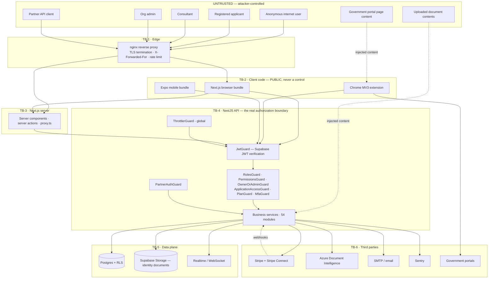

# VisaAI — Security Architecture

> Engagement: Master Security Audit, 2026-08-16.
> Branch `security/master-audit-2026-08-16`, starting commit `13815351`.
> Derived from source inspection, not from prior documentation. Where a claim
> could only be verified on the production host it is marked **NOT VERIFIED**.

## 1. What the system is

VisaAI is a multi-tenant, multi-country immigration application platform. Users
(applicants) prepare visa applications; consultants advise them for a fee;
organisations group consultants; platform staff administer the whole estate. The
data it holds is high-sensitivity by definition: passports, birth certificates,
police certificates, bank statements, biographic and immigration-status data, and
payment records.

## 2. Deployment topology (as configured in-repo)

| Surface | Tech | Runtime | Public entry |
|---|---|---|---|
| `apps/web` | Next.js 16 (App Router, 15 locales) | Hostinger VPS, behind nginx, port 3002 | `visaai.co` |
| `apps/api` | NestJS 11, 54 modules, 70 controllers, 319 routes | same VPS, behind nginx, port 4000 | `api.visaai.co` |
| `apps/extension` | Chrome MV3 | user's browser | Chrome Web Store |
| `apps/mobile` | Expo / React Native | code-complete, **not shipped** | — |
| `apps/sidecar` | *(removed in `369607e`)* | dead — only a stray `node_modules/` remains | — |
| `packages/partner-sdk` | published SDK | third-party partners | npm |
| Database / auth / storage | **Self-hosted Supabase** (Postgres, GoTrue, PostgREST, Storage, Realtime, Kong) in Docker on the same VPS; containers named `selfhosted_*` | VPS | via Kong |

Production Supabase is the **self-hosted** stack on the VPS. Migrations are
applied by piping SQL into the `selfhosted_db` container.

## 3. Trust boundaries



### Boundary rules

| # | Boundary | Rule that must hold |
|---|---|---|
| TB-1 | Internet → nginx | nginx must **overwrite** `X-Forwarded-For`, not append to a client-supplied value; the app sets `trust proxy 1`, so a spoofable header defeats both per-IP throttling and login lockout. |
| TB-2 | Client code → anything | Browser/extension/mobile code is public. No secret, no authorization decision, and no price may live there. Every client-side check must be re-enforced server-side. |
| TB-3 | Next.js server | Server actions and route handlers are public HTTP endpoints; each must re-authenticate and re-authorize. |
| TB-4 | API | The single authoritative authorization boundary. Identity comes only from a cryptographically verified Supabase JWT; role comes only from a verified claim or a server-side DB lookup — never from a request body or header. |
| TB-5 | Data | Every query must be scoped by owner **and** tenant. Where the service-role key is used, RLS is bypassed, so the application must supply the filter itself. |
| TB-6 | Third parties | Inbound webhooks are untrusted until signature-verified against the raw body. Outbound calls must not carry more PII than the integration requires. |
| — | Document contents | OCR/extracted text from an uploaded document is **untrusted input**, including when it reaches an LLM prompt. |
| — | Model output | LLM output is untrusted input. It may never be an authorization layer, and must not be rendered as HTML or executed. |

## 4. Defence-in-depth layers (target state)

```
INTERNET
  ↓  TLS · nginx (headers, body caps, limit_req)
  ↓  ThrottlerGuard (global, per-IP/user)
  ↓  JwtGuard (Supabase JWT signature + expiry)
  ↓  RolesGuard / PermissionsGuard / PlanGuard / MfaGuard
  ↓  Ownership + tenant scoping in the service layer
  ↓  Schema validation (zod) on request bodies
  ↓  Business logic
  ↓  Postgres RLS (defence in depth behind the API)
  ↓  Storage policies (identity documents)
```

Layer-by-layer current state, gaps, and what this engagement changed are recorded
in `SECURITY_AUDIT_REPORT.md` and `SECURITY_REMEDIATION_LEDGER.md`.

## 5. Identity and roles

Authentication is **Supabase only** (email/password, OAuth Google/Azure, anonymous
guest sessions, TOTP MFA). There is no NextAuth and no Passport. On top of
Supabase auth sits an in-house IAM layer (`apps/api/src/modules/iam/`) providing
a six-role catalogue, per-permission grants, organisations, memberships and
invitations, brute-force lockout, login history and an auth audit log.

Roles, and the full role × route × data matrix, are in `RBAC_SECURITY_MATRIX.md`.

## 6. Known architectural risk concentrations

1. **Service-role key usage.** Any API path using the Supabase service-role key
   bypasses RLS entirely; correctness then depends solely on the application's
   own filters.
2. **Identity documents in object storage.** Bucket policy plus object-key
   scheme is the last line between a tenant and another tenant's passport scans.
3. **Document → LLM path.** Attacker-supplied file content reaching a prompt is
   the highest-value indirect prompt-injection target in the product.
4. **Money movement.** Consultant payouts via Stripe Connect: an authorization or
   idempotency defect converts directly into cash loss.
5. **Browser extension on government portals.** The extension holds user session
   context and operates on third-party pages it does not control.
